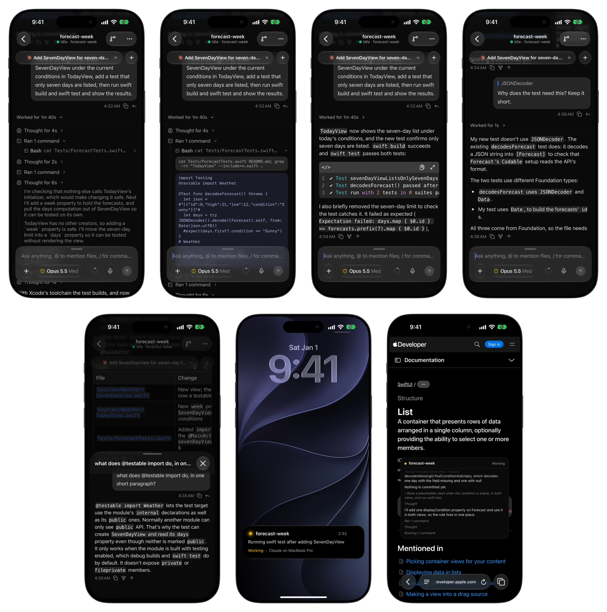

<div align="center">


# orca-ios

Community-maintained iPhone client for [Orca](https://github.com/stablyai/orca).

[](https://github.com/huami1314/orca-ios/actions/workflows/ci.yml)
[](https://github.com/huami1314/orca-ios/releases)
[](https://github.com/huami1314/orca-ios)
[](LICENSE)

**English** · [简体中文](README_ZH-CN.md)

</div>

<p align="center">
  
</p>

## Features

| | Feature | Details |
| --- | --- | --- |
| **System** | Live Activities | Shown on the Lock Screen and in the Dynamic Island while an agent works; the light tells working, needs you and done apart |
| | Picture in Picture | A chat or terminal keeps running in a floating window after you leave the app; opens on its own while an agent works |
| | Push notifications | Arrive through the push gateway even with the app closed; tapping one opens its workspace |
| **Chat** | Paste and drop files | Paste or drag photos, videos and documents into the composer; they upload as soon as they're added, and send waits for them |
| | Quote | Select text in a reply and quote it into the next message, shown with a bar |
| | `/btw` | Ask a side question without interrupting the chat; the answer opens in a half sheet and goes away when closed |
| | Streaming | Thoughts come in word by word, and a light haptic marks the end of a reply |
| | Tool calls | Commands and file edits open in place in two levels; terminal output keeps its ANSI colours |
| | Sending while working | Tap send to steer or to queue, hold it for the other |
| | Background tasks | Background agents, shells and queued messages share one scrolling bar where you can check or stop them |
| | Context ring | The composer shows how much context is used; tap for the breakdown |
| | Composer | One line until you type, then a card; pull up for a full-screen editor; `/` commands, `@` files, drafts kept per chat |
| | Photos | The photo picker opens in place from the composer, videos included |
| | File paths | Paths in a reply open a preview when tapped |
| **Interface** | Liquid Glass | Navigation bars, tab bar, menus and sheets are system controls with Liquid Glass |
| | Terminal | [Ghostty](https://github.com/ghostty-org/ghostty), via [libghostty-spm](https://github.com/Lakr233/libghostty-spm) by [Lakr233](https://github.com/Lakr233), with Esc, Tab, Ctrl and Alt keys |
| | Tabs | Hide the bottom tabs you don't use |
| | Cache | Chats, workspaces and images are cached, so the last view is there when the app opens |
| | Languages | English, Simplified Chinese and Traditional Chinese |

## Push notifications

Notifications reach this app through the community push gateway at `https://orca-push.huami.dev`. On the Mac running Orca:

```sh
launchctl setenv ORCA_PUSH_GATEWAY_URL https://orca-push.huami.dev
```

Then restart Orca. The welcome screen in the app has a prompt you can copy to an AI agent to do this for you.

> [!NOTE]
> A desktop sends notifications through one gateway at a time. With this one set, the official Orca app on the same desktop stops receiving them. Unset the variable and restart Orca to switch back.

To run your own gateway, see [`gateway/`](gateway/README.md) (Node.js or Docker) or `gateway-worker/` (Cloudflare Workers).

## Building

Requires Xcode 26 and [XcodeGen](https://github.com/yonaskolb/XcodeGen).

```sh
git clone https://github.com/huami1314/orca-ios.git
cd orca-ios
xcodegen
open Orca.xcodeproj
```

| Command | Does |
| --- | --- |
| `scripts/sim.sh <udid> <shot.png>` | Builds, installs and launches on a simulator, then takes a screenshot |
| `scripts/ipa.sh [out.ipa]` | Builds an unsigned Release IPA |
| `cd packages/OrcaCore && swift test` | Runs the protocol tests (pairing, encryption, RPC) |

## Contributing

Issues and pull requests are welcome. Read [CONTRIBUTING.md](CONTRIBUTING.md) first; commits follow [Conventional Commits](https://www.conventionalcommits.org).

## License

[MIT](LICENSE). See [NOTICE.md](NOTICE.md) for the relationship with Orca and third-party licenses.

## Acknowledgements

- [Orca](https://github.com/stablyai/orca)
- [Ghostty](https://github.com/ghostty-org/ghostty) and [libghostty-spm](https://github.com/Lakr233/libghostty-spm) by [Lakr233](https://github.com/Lakr233)
- [MarkdownView](https://github.com/Lakr233/MarkdownView) by [Lakr233](https://github.com/Lakr233)
- [Lucide](https://github.com/lucide-icons/lucide)

## Star History

[](https://star-history.com/#huami1314/orca-ios&Date)
