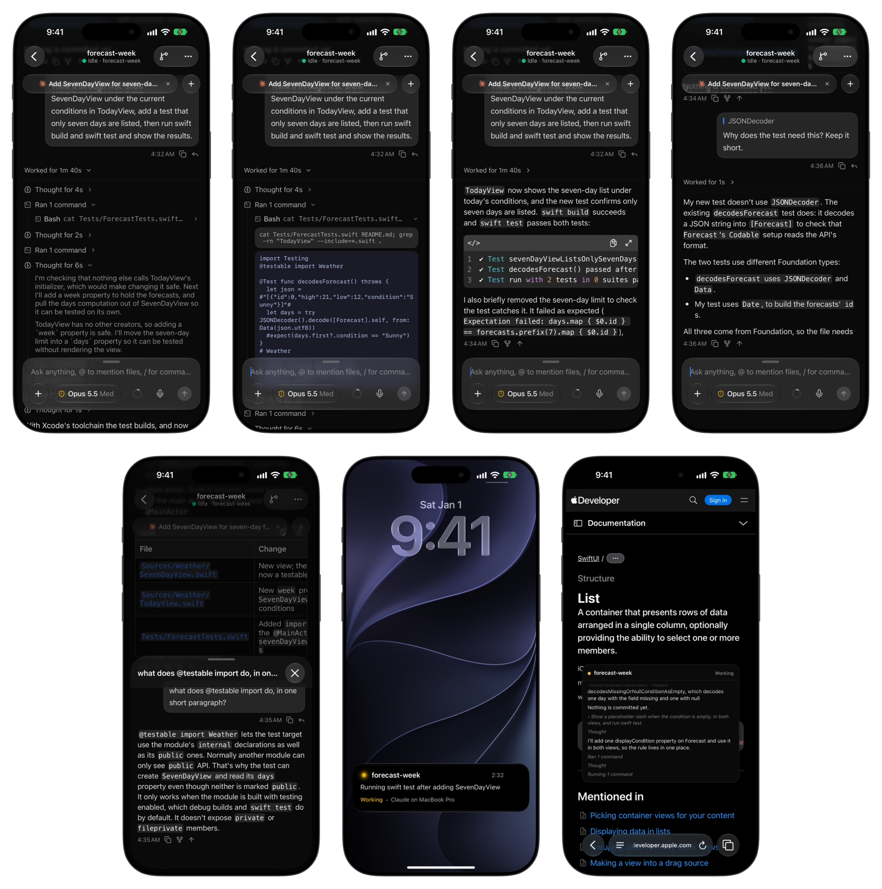

<div align="center">


# orca-ios

[Orca](https://github.com/stablyai/orca) 的社区维护 iPhone 客户端。

[](https://github.com/huami1314/orca-ios/actions/workflows/ci.yml)
[](https://github.com/huami1314/orca-ios/releases)
[](https://github.com/huami1314/orca-ios)
[](LICENSE)

[English](README.md) · **简体中文**

</div>

<p align="center">
  
</p>

## 功能

| | 功能 | 说明 |
| --- | --- | --- |
| **系统集成** | 实时活动 | 智能体工作时显示在锁屏和灵动岛，状态灯区分工作中、需要你操作、已完成 |
| | 画中画 | 聊天或终端开成画中画，离开 App 后继续看输出；智能体工作时自动打开 |
| | 推送通知 | 经推送网关送达，App 关掉也能收到，点开直达对应工作区 |
| **聊天** | 粘贴、拖入文件 | 照片、视频、文档可以粘贴或拖进输入框，添加时就开始上传，传完才能发送 |
| | 引用 | 选中回答里的文字，引用到下一条消息，带竖条显示 |
| | `/btw` 旁问 | 不打断当前对话问一个旁支问题，回答在半屏卡片里，看完即关 |
| | 流式呈现 | 思考逐字流出，回答结束时轻震一次 |
| | 工具调用 | 命令和文件改动原地两级展开，终端输出保留 ANSI 颜色 |
| | 发送方式 | 智能体工作时轻点发送可插话或排队，长按选另一种 |
| | 后台任务 | 后台智能体、shell 和排队消息合成一条可横向滑动的工具栏，可以查看、停止 |
| | 上下文用量 | 输入框里的圆环显示上下文占用，点开看明细 |
| | 输入框 | 平时一行，写字时展开成卡片，上拉全屏编辑；`/` 命令、`@` 文件补全，草稿按会话保存 |
| | 照片 | 选图面板从输入框原地展开，可选视频 |
| | 文件路径 | 回答里的文件路径点一下就能预览 |
| **界面** | Liquid Glass | 导航栏、标签栏、菜单、半屏卡片都是系统控件和 Liquid Glass 材质 |
| | 终端 | [Ghostty](https://github.com/ghostty-org/ghostty) 绘制，经 [Lakr233](https://github.com/Lakr233) 的 [libghostty-spm](https://github.com/Lakr233/libghostty-spm) 接入，带 Esc、Tab、Ctrl、Alt 按键 |
| | 标签页 | 用不到的底部标签可以隐藏 |
| | 缓存 | 会话、工作区列表、聊天图片都有缓存，打开就是上次的内容 |
| | 语言 | 英文、简体中文、繁体中文 |

## 推送通知

推送经社区推送网关 `https://orca-push.huami.dev` 发到这个 App。在运行 Orca 的 Mac 上执行：

```sh
launchctl setenv ORCA_PUSH_GATEWAY_URL https://orca-push.huami.dev
```

然后重启 Orca。App 的欢迎页里有一段提示词，复制给 AI agent 就能替你完成。

> [!NOTE]
> 一台桌面同一时间只走一个推送网关。设置之后，这台桌面上官方 Orca App 就收不到推送了。取消这个变量并重启 Orca 即可换回。

自己部署网关见 [`gateway/`](gateway/README.md)（Node.js 或 Docker）或 `gateway-worker/`（Cloudflare Workers）。

## 构建

需要 Xcode 26 和 [XcodeGen](https://github.com/yonaskolb/XcodeGen)。

```sh
git clone https://github.com/huami1314/orca-ios.git
cd orca-ios
xcodegen
open Orca.xcodeproj
```

| 命令 | 作用 |
| --- | --- |
| `scripts/sim.sh <udid> <shot.png>` | 构建、安装到模拟器并启动，然后截图 |
| `scripts/ipa.sh [out.ipa]` | 构建未签名的 Release IPA |
| `cd packages/OrcaCore && swift test` | 跑协议层测试（配对、加密、RPC） |

## 参与贡献

欢迎提 Issue 和 Pull Request，先看 [CONTRIBUTING.md](CONTRIBUTING.md)。提交信息遵循 [Conventional Commits](https://www.conventionalcommits.org/zh-hans/)。

## 许可证

[MIT](LICENSE)。与 Orca 的关系和第三方许可见 [NOTICE.md](NOTICE.md)。

## 致谢

- [Orca](https://github.com/stablyai/orca)
- [Ghostty](https://github.com/ghostty-org/ghostty) 与 [libghostty-spm](https://github.com/Lakr233/libghostty-spm)（[Lakr233](https://github.com/Lakr233)）
- [MarkdownView](https://github.com/Lakr233/MarkdownView)（[Lakr233](https://github.com/Lakr233)）
- [Lucide](https://github.com/lucide-icons/lucide)

## Star History

[](https://star-history.com/#huami1314/orca-ios&Date)
